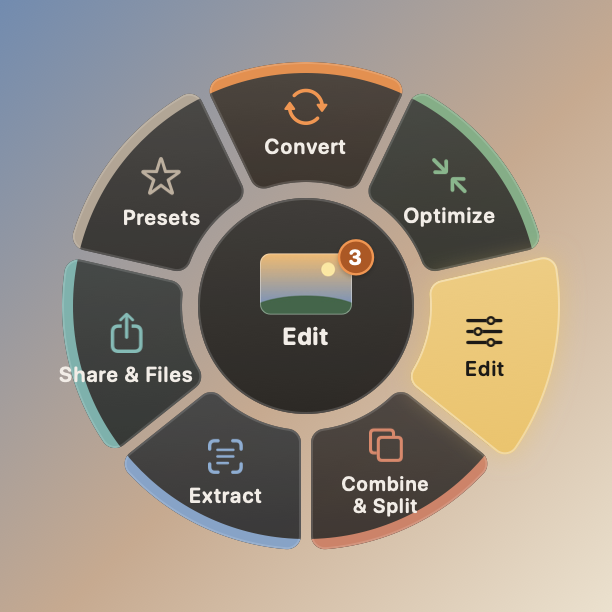
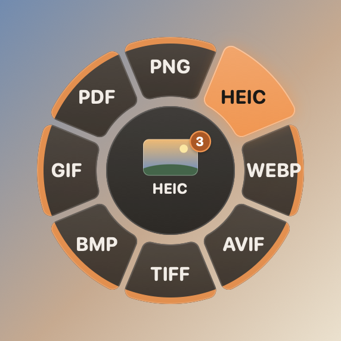
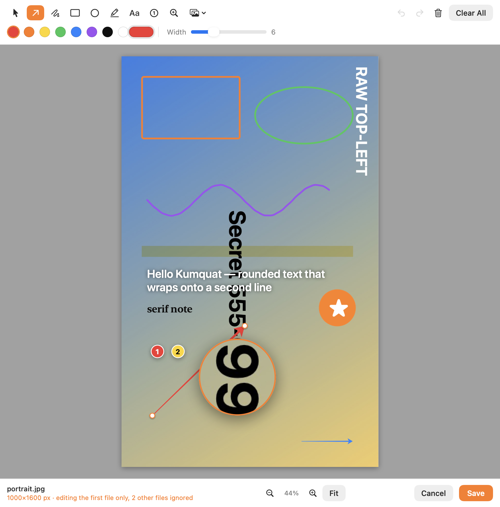
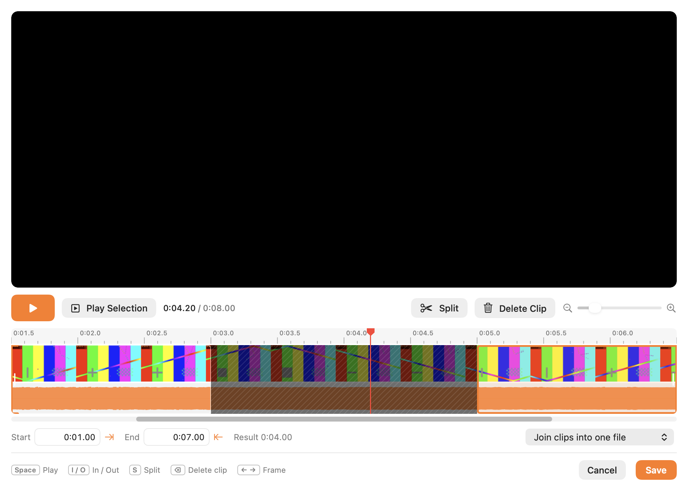

<p align="center">
  
</p>

<h1 align="center">Kumquat</h1>

<p align="center">
  A menu-bar file converter for macOS: drag files, tap <kbd>⇧ Shift</kbd>, drop on a petal.<br>
  Apple Silicon · macOS 14+ · English / Русский
</p>

<p align="center">
  <a href="README.ru.md">Читать на русском</a> ·
  <a href="LICENSE">MIT License</a>
</p>

<p align="center">
  
  
</p>

## How it works

1. Start dragging files in Finder (or any app).
2. While still holding the mouse button, tap **⇧ Shift**. A wheel opens under the cursor.
3. Hover a category to open it. Hover the centre to go back.
4. Drop the files on a petal. Results are saved next to the originals, which are never modified.

The wheel only shows categories and actions that apply to every dragged file. No Accessibility
permission is needed: Kumquat polls the mouse, modifier keys and the system drag pasteboard.

Other ways in: the menu-bar item (**Open Files in Wheel…**), right-click › **Services** in Finder,
the global hotkey <kbd>⌃⌥K</kbd> for the current Finder selection, watch folders, and a CLI.

## Features

| Category | What it does |
|---|---|
| **Convert** | Images: JPG, PNG, HEIC, WebP, AVIF, TIFF, BMP, GIF, SVG, PDF. Audio: MP3, M4A, WAV, FLAC, OGG, Opus, AIFF, WMA. Video: MP4, MOV, MKV, WebM, AVI, WMV, GIF. Documents: PDF, DOCX, ODT, RTF, RTFD, HTML, Markdown, TXT, EPUB; plus PPTX, Keynote, Pages, Numbers, DOC, XLS as input. Spreadsheets: XLSX, CSV, TSV. Subtitles: SRT, VTT. Archives: ZIP, TAR, TAR.GZ |
| **Optimize** | Compress (quality presets or a target size), strip metadata, loudness normalization, cut silence |
| **Edit** | Interactive editors (below), crop, frame, remove background, blur faces, video speed, crop video, mute, mono/stereo |
| **Combine & Split** | Collage, images → PDF, merge/split PDF, join/split video, audio visualizer, zip |
| **Extract** | Read QR codes, recognize text (OCR), video snapshots, extract archives |
| **Share & Files** | Float shelf, AirDrop, copy, copy path, move, open in Terminal |
| **Presets** | Your own one-tap recipes, e.g. "Email (≤2 MB JPG)" or "Instagram 4:5" |

### Interactive editors

| Editor | Highlights |
|---|---|
| **Annotate** | Arrows, pen, shapes, highlighter, text, numbered steps, magnifier, stickers |
| **Redact** | Blur / pixelate / solid boxes, automatic face and text detection |
| **Adjust** | 22 Core Image adjustments, presets, before/after, batch apply |
| **Organize PDF** | Reorder, rotate, delete, duplicate, insert and merge pages |
| **Trim** | Timeline with thumbnails and waveform, split into clips, remove clips, auto-trim silence |
| **Bleep** | Draw bleep ranges on the waveform, 1 kHz tone or silence, preview |
| **Redact Video** | Boxes with per-box time ranges on a layer timeline, face detection |

All editors share the same shortcuts (⌘S, Esc, ⌘Z/⇧⌘Z, Space) and ask before discarding unsaved changes.

<p align="center">
  
  
</p>

### Under the hood

- Hardware H.264/HEVC encoding through VideoToolbox, with parallel jobs across files.
- Friendly error messages, a **Recent** history menu with **Run Again**, and a progress HUD with cancel.
- Bundled ffmpeg, ffprobe and cwebp, built from official sources under the **LGPL** and targeting macOS 14.
- Native frameworks everywhere else: ImageIO, Core Image, Vision, PDFKit, AVFoundation, WebKit, textutil.

## Install

Download the DMG from [Releases](../../releases), install with Homebrew:

```bash
brew install --cask thealexray/tap/kumquat
```

or build it yourself (below). Builds are ad-hoc
signed until a Developer ID is set up, so macOS blocks the first launch:

- **macOS 15 and later:** open Kumquat once, then go to **System Settings › Privacy & Security**,
  scroll down and click **Open Anyway**.
- **macOS 14:** right-click Kumquat in Applications, choose **Open**, then **Open** again.
- Or, once in Terminal: `xattr -dr com.apple.quarantine /Applications/Kumquat.app`

## Build

Requires the Xcode Command Line Tools (Xcode itself is not needed) and Homebrew for build tools.

```bash
brew install meson ninja cmake pkgconf
./scripts/build-ffmpeg.sh          # LGPL ffmpeg + codecs from official sources (first run takes a while)
./scripts/build-app.sh --install   # builds build/Kumquat.app and copies it to ~/Applications
```

For quick development without the bundled toolchain, `brew install ffmpeg webp`, then
`swift build && .build/debug/Kumquat`. See [docs/RELEASE.md](docs/RELEASE.md) for the DMG,
signing and notarization.

## Command line

```bash
Kumquat --convert webp photo.png scan.heic
Kumquat --tool compress video.mov
Kumquat --list
```

The binary is `Kumquat.app/Contents/MacOS/Kumquat`. CLI output is always in English.

## Tests

```bash
./scripts/test-suite.sh            # ~400 conversion and tool cases with output validation
./scripts/test-suite.sh --quick    # one representative per group
python3 scripts/check-l10n.py      # missing or unused localization keys
```

See [docs/TESTING.md](docs/TESTING.md).

## Project layout

| Folder | Contents |
|---|---|
| `Sources/Kumquat/Model` | Formats, conversion matrix, tool catalog, settings, presets, shared contracts |
| `Sources/Kumquat/App` | Drag gesture monitor, job coordinator, actions, menu bar, history, Finder services, hotkey, watch folders, CLI |
| `Sources/Kumquat/Fan` | The radial wheel |
| `Sources/Kumquat/Engine` | Image, media (ffmpeg), document, EPUB, Office/iWork, spreadsheet, subtitle and archive engines, tool modules |
| `Sources/Kumquat/Editors` | The seven interactive editors and their shared window, canvas and timeline code |
| `Sources/Kumquat/UI` | Theme, HUD, tool options, settings, welcome, float shelf |
| `Resources` | App icon, `en.lproj` and `ru.lproj` strings |
| `scripts` | Build, toolchain, release, test and localization scripts |

## Credits

Made by **kipperstudio** and **Claude** (an AI model by Anthropic).

Bundled third-party software: FFmpeg (LGPL 2.1+), libwebp, LAME, Opus, libvpx, dav1d, SVT-AV1,
libpng, libjpeg-turbo, xz. See [THIRD_PARTY_NOTICES.md](THIRD_PARTY_NOTICES.md); the licenses ship inside the app at `Contents/Resources/Tools/licenses`
and are listed in **Settings › About › Licenses…**.

## License

Kumquat's source code is released under the [MIT License](LICENSE). © 2026 kipperstudio.
