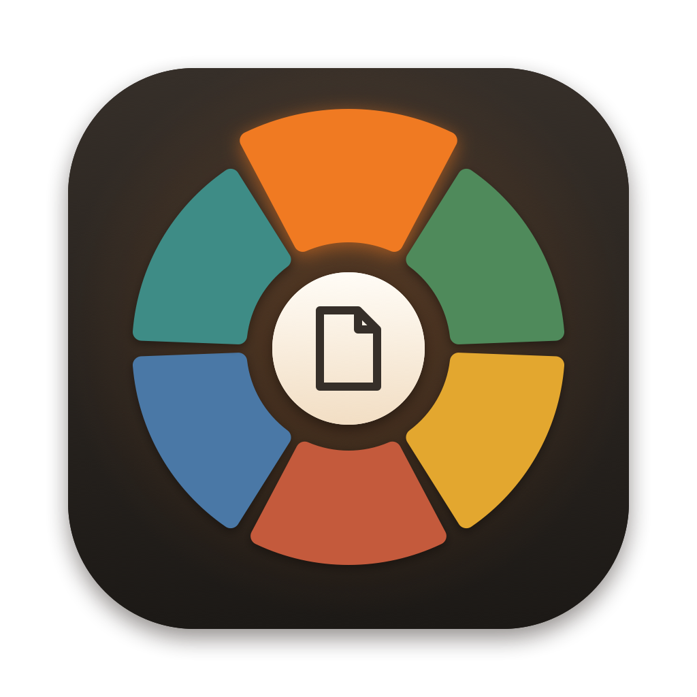
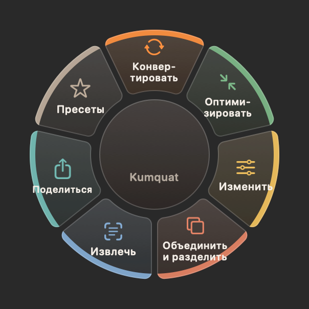
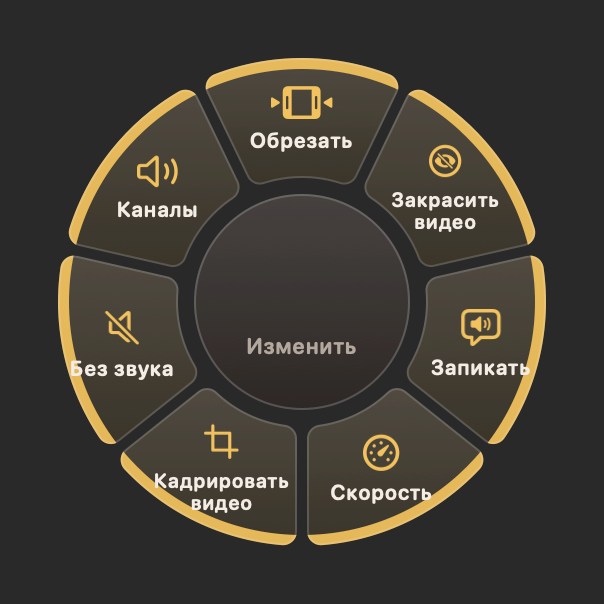
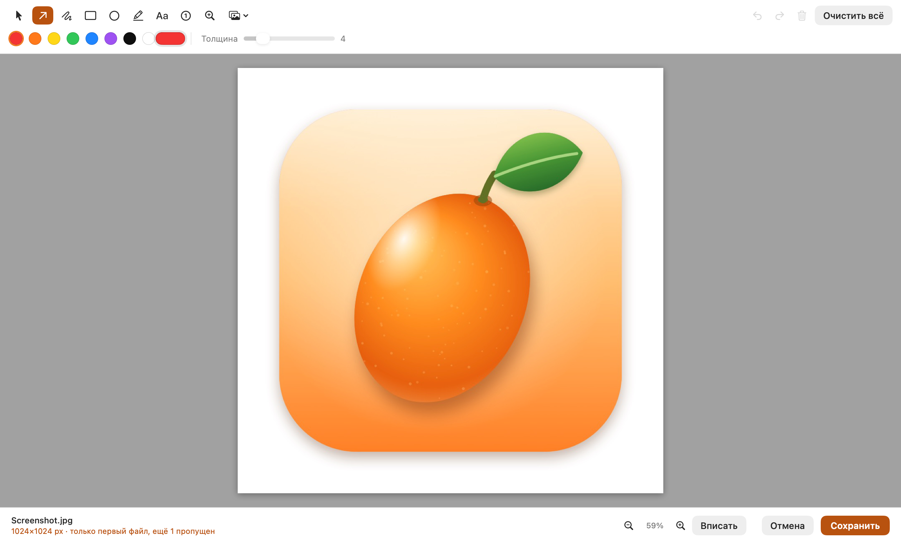
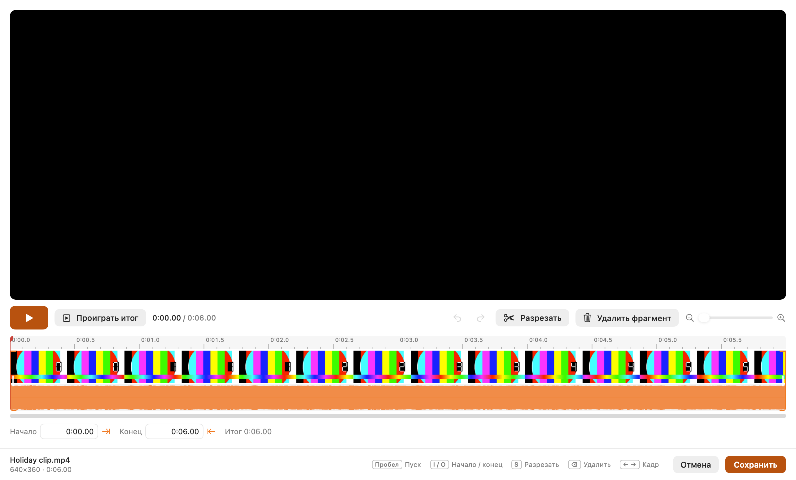

<p align="center">
  
</p>

<h1 align="center">Kumquat</h1>

<p align="center">
  Конвертер файлов в строке меню macOS: перетащите файлы, коснитесь <kbd>⇧ Shift</kbd>, бросьте на лепесток.<br>
  Apple Silicon · macOS 14+ · English / Русский
</p>

<p align="center">
  <a href="README.md">Read in English</a> ·
  <a href="LICENSE">Лицензия MIT</a>
</p>

<p align="center">
  
  
</p>

## Как это работает

1. Начните перетаскивать файлы в Finder (или в любом приложении).
2. Не отпуская кнопку мыши, коротко нажмите **⇧ Shift**: под курсором появится колесо.
3. Задержите курсор на категории, и она раскроется. Задержка на центре возвращает назад.
4. Бросьте файлы на лепесток. Результат сохранится рядом с оригиналами, сами оригиналы не меняются.

Колесо показывает только категории и действия, подходящие ко всем перетаскиваемым файлам.
Разрешение Accessibility не нужно: Kumquat опрашивает мышь, клавиши-модификаторы и системный
буфер перетаскивания.

Другие способы открыть колесо: пункт в строке меню («Открыть файлы в колесе…»), правый клик ›
**Службы** в Finder, горячая клавиша <kbd>⌃⌥K</kbd> для выделенных в Finder файлов,
наблюдаемые папки и командная строка.

## Возможности

| Категория | Что умеет |
|---|---|
| **Конвертировать** | Картинки: JPG, PNG, HEIC, WebP, AVIF, TIFF, BMP, GIF, SVG, PDF. Аудио: MP3, M4A, WAV, FLAC, OGG, Opus, AIFF, WMA. Видео: MP4, MOV, MKV, WebM, AVI, WMV, GIF. Документы: PDF, DOCX, ODT, RTF, RTFD, HTML, Markdown, TXT, EPUB; на вход также PPTX, Keynote, Pages, Numbers, DOC, XLS. Таблицы: XLSX, CSV, TSV. Субтитры: SRT, VTT. Архивы: ZIP, TAR, TAR.GZ |
| **Оптимизировать** | Сжатие (пресеты качества или целевой размер), удаление метаданных, выравнивание громкости, вырезание тишины |
| **Изменить** | Интерактивные редакторы (ниже), кадрирование, рамка, удаление фона, размытие лиц, скорость видео, кадрирование видео, без звука, моно/стерео |
| **Объединить и разделить** | Коллаж, картинки → PDF, склейка и разбиение PDF и видео, визуализатор звука, zip |
| **Извлечь** | QR-коды, распознавание текста (OCR), кадры из видео, распаковка архивов |
| **Поделиться** | Полка Float, AirDrop, копировать, скопировать путь, переместить, открыть в Терминале |
| **Пресеты** | Свои рецепты в одно касание, например «Почта (JPG ≤2 МБ)» или «Instagram 4:5» |

### Интерактивные редакторы

| Редактор | Что умеет |
|---|---|
| **Разметка** | Стрелки, перо, фигуры, маркер, текст, нумерованные шаги, лупа, стикеры |
| **Закрасить** | Размытие, пикселизация или заливка, автопоиск лиц и текста |
| **Коррекция** | 22 настройки Core Image, пресеты, сравнение «до/после», пакетное применение |
| **Страницы PDF** | Перестановка, поворот, удаление, дублирование, вставка и слияние страниц |
| **Обрезать** | Таймлайн с кадрами и формой волны, разрез на клипы, удаление клипов, автообрезка тишины |
| **Запикать** | Отрезки «бипа» на форме волны, тон 1 кГц или тишина, предпрослушивание |
| **Закрасить видео** | Области с собственными отрезками времени на слоях таймлайна, поиск лиц |

Во всех редакторах одинаковые клавиши (⌘S, Esc, ⌘Z/⇧⌘Z, пробел), а перед закрытием с
несохранёнными правками появляется вопрос.

<p align="center">
  
  
</p>

### Внутри

- Аппаратное кодирование H.264/HEVC через VideoToolbox и параллельная обработка файлов.
- Понятные ошибки, меню «Недавние» с «Повторить» и окно прогресса с отменой.
- Встроенные ffmpeg, ffprobe и cwebp, собранные из официальных исходников под **LGPL** для macOS 14.
- Всё остальное на системных фреймворках: ImageIO, Core Image, Vision, PDFKit, AVFoundation, WebKit, textutil.

## Установка

Скачайте DMG из раздела [Releases](../../releases), установите через Homebrew:

```bash
brew install --cask thealexray/tap/kumquat
```

или соберите приложение сами (ниже). Пока нет
подписи Developer ID, при первом запуске откройте приложение через правый клик › **Открыть**.

## Сборка

Нужны Command Line Tools (сам Xcode не нужен) и Homebrew для инструментов сборки.

```bash
brew install meson ninja cmake pkgconf
./scripts/build-ffmpeg.sh          # LGPL-ffmpeg и кодеки из официальных исходников (первый раз долго)
./scripts/build-app.sh --install   # собирает build/Kumquat.app и копирует в ~/Applications
```

Для быстрой разработки без встроенных инструментов: `brew install ffmpeg webp`, затем
`swift build && .build/debug/Kumquat`. DMG, подпись и нотаризация описаны в
[docs/RELEASE.md](docs/RELEASE.md).

## Командная строка

```bash
Kumquat --convert webp photo.png scan.heic
Kumquat --tool compress video.mov
Kumquat --list
```

Исполняемый файл лежит в `Kumquat.app/Contents/MacOS/Kumquat`. Вывод CLI всегда на английском.

## Тесты

```bash
./scripts/test-suite.sh            # ~400 конвертаций и инструментов с проверкой результата
./scripts/test-suite.sh --quick    # по одному примеру на группу
python3 scripts/check-l10n.py      # непереведённые и лишние строки
```

Подробнее в [docs/TESTING.md](docs/TESTING.md).

## Авторы

Сделано **kipperstudio** и **Claude** (ИИ-модель от Anthropic).

Встроенные сторонние компоненты: FFmpeg (LGPL 2.1+), libwebp, LAME, Opus, libvpx, dav1d, SVT-AV1,
libpng, libjpeg-turbo, xz. Их лицензии лежат внутри приложения в `Contents/Resources/Tools/licenses`
и доступны в **Настройки › О программе › Лицензии…**.

## Лицензия

Исходный код Kumquat распространяется по [лицензии MIT](LICENSE). © 2026 kipperstudio.
